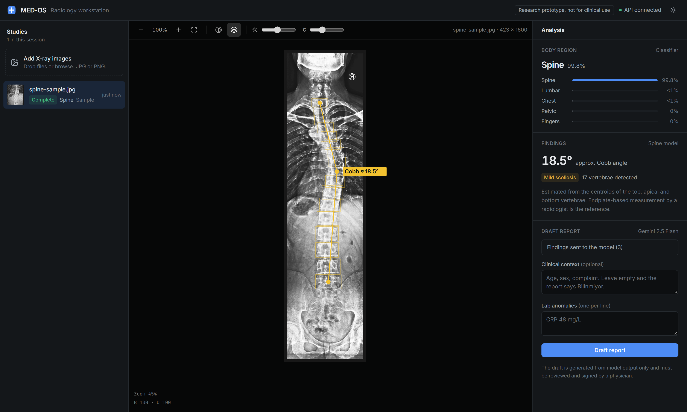

# MED-OS

[](https://github.com/hamzacakmakk/MED-OS/actions/workflows/ci.yml)

An AI-assisted radiology workstation. Upload an X-ray, and the system decides which body region it is
looking at, runs the matching detection model, and drafts a Turkish clinical report from the findings.



> **Research prototype — not a medical device.** Nothing here is validated, certified, or cleared by any
> regulator. Model output is not a diagnosis and must never be used to make a clinical decision about a
> real patient. See [Status](#status) for what is actually finished.

## How it works

Analysis is a two-stage pipeline. A classifier routes the image; a specialist model reads it.

```
upload  ──▶  FastAPI /yolo/detect/  ──▶  Celery queue (Redis)
                                              │
                                              ▼
                                   classification.onnx  ──▶  region: chest │ knee │ spine │ skull │ elbow
                                              │
                                              ▼
                                   region-specific YOLO model
                                              │
                                              ▼
                              findings ──▶ Supabase (image + analysis JSON)
                                              │
                                              ▼
                              POST /api/generate-report  ──▶  Gemini 2.5 Flash  ──▶  draft report
```

Detection returns immediately with a `task_id`; the client polls `/yolo/task/{task_id}` for the result.
Heavy inference never blocks the API.

### Per-region logic

Each region does something different with the model output, not just a bounding box dump:

| Region | Model | Output |
|---|---|---|
| **Spine** | `spine.pt` | Detects vertebrae, sorts them top-to-bottom, approximates a **Cobb angle** from the top/apex/bottom centroids, and grades scoliosis severity |
| **Knee** | `knee.pt` | Classification — osteoarthritis grade with confidence |
| **Chest** | `chest.pt` | Detection — pathology labels with confidence and coordinates |
| **Skull** | `skull.pt` | Detection — pathology labels with confidence and coordinates |
| **Elbow** | `elbow.pt` | Model loaded, routing not yet wired |

### Reporting

`reporting.py` sends findings to Gemini 2.5 Flash under a prompt built for SGK-format Turkish medical
reports (Anamnez / Muayene Bulguları / Laboratuvar / Epikriz). The prompt is written defensively — it
forbids inventing patient history, forces "Bilinmiyor" for missing fields, and restricts the model to
interpreting labels it was actually given. Output is plain text, ready for a physician to review and sign.

## Stack

**Backend** — FastAPI · Ultralytics YOLO · ONNX Runtime · Celery + Redis · Supabase (Postgres + Storage) ·
python-jose + passlib (JWT auth) · Google GenAI

**Frontend** — React 19 · Vite 7 · Tailwind CSS 4 · Zustand · react-dropzone · lucide-react

The UI is a three-pane reading workstation wired to the real API:

- **Studies** (left) — drag in one or more X-rays; each is uploaded, queued and polled until the worker
  finishes. Status is shown per study.
- **Viewer** (center) — zoom, pan, invert, brightness/contrast, and the model output drawn on the image in
  image coordinates: detection boxes with labels, or for spine films every detected vertebra plus the
  top/apex/bottom line used for the Cobb estimate. Keyboard: `+` `-` `0` `I` `O`.
- **Analysis** (right) — region classification with the top-5 probabilities, region-specific findings
  (hovering a finding highlights its box), and the report draft: optional clinical context and lab
  anomalies go to `/api/generate-report`, and the returned text is editable, copyable and downloadable.

Without a backend you can still open **the sample study** (or visit `/?sample`): a full-spine radiograph
with the output the spine model actually produced for it, saved in `frontend/public/samples/`.

## Running it

### Requirements

Python 3.11+, Node 18+, Redis, and a Supabase project.

### Backend

```bash
cd backend/full_api
python -m venv .venv && source .venv/bin/activate   # Windows: .venv\Scripts\activate
pip install -r requirements.txt
```

Create `backend/full_api/.env` (git-ignored — never commit it):

```env
SUPABASE_URL=https://your-project.supabase.co
SUPABASE_KEY=your-service-key
SECRET_KEY=your-jwt-signing-secret
GEMINI_API_KEY=your-google-genai-key
```

Supabase needs a `xrays` storage bucket and a `xray_analysis` table with columns
`file_name`, `file_path`, `analysis` (jsonb).

Start Redis, the worker, and the API — three terminals:

```bash
redis-server

celery -A app.celery_app.celery worker --pool=solo --loglevel=info

uvicorn app.main:app --reload --port 8000
```

API docs land at `http://127.0.0.1:8000/docs`.

### Frontend

```bash
cd frontend
npm install
npm run dev
```

Runs on `http://localhost:5173`, which is already in the backend CORS allowlist.

## API

| Method | Endpoint | Purpose |
|---|---|---|
| `POST` | `/yolo/detect/` | Upload one or more images; returns a `task_id` per file |
| `GET` | `/yolo/task/{task_id}` | Poll analysis status and result |
| `POST` | `/api/generate-report` | Turn findings + lab anomalies into a drafted report |
| `*` | `/auth/*` | Authentication (partial — see below) |

## Layout

```
backend/full_api/app/
  main.py           FastAPI app, CORS, router wiring
  yolo_choser.py    classifier + per-region analysis + detect endpoints
  tasks.py          Celery task: upload → predict → route → persist
  celery_app.py     Celery/Redis config
  reporting.py      Gemini report generation
  db.py             Supabase client, storage upload, analysis persistence
  auth.py           JWT scaffolding
  models/           classification.onnx + 5 region YOLO weights

frontend/src/
  App.jsx                  three-pane layout, theme
  lib/api.js               upload, task polling, report requests
  lib/store.js             studies state (Zustand)
  lib/findings.js          normalizes per-region model output for the UI and the report prompt
  components/StudyList     upload + study queue
  components/Viewer        image viewer and SVG overlay
  components/AnalysisPanel region, findings
  components/ReportPanel   report drafting
```

The five `.pt` weights are tracked with Git LFS (`classification.onnx` is not) — run `git lfs install` before cloning.

## Status

Working end to end: upload → async queue → classify → region model → Supabase → Gemini report.

Known gaps, roughly in priority order:

- `requirements.txt` is unpinned
- `auth.py` is scaffolding — hashing and token helpers exist, but no login/register routes are mounted
- Root `docker-compose.yml` is empty; the working compose file is `backend/full_api/app/docker.yaml` and covers only Redis and the worker
- Elbow routing is unimplemented, so elbow images fall through to the default response
- No DICOM support yet — uploads are `.jpg`/`.png` only
- No test suite

The longer-term plan — DICOM/PACS, HL7/FHIR, RAG-grounded reporting, KVKK/HIPAA hardening — is written up
in [`ekip_gorev_dagilimi.md`](ekip_gorev_dagilimi.md).

## Contributing

Work happens on per-developer branches (`hamza`, `mehmet`, `cihan`, `tufan`, `turgut`) merged into `main`.
Branch from `main`, keep `.env` out of every commit, and never commit patient imagery.
